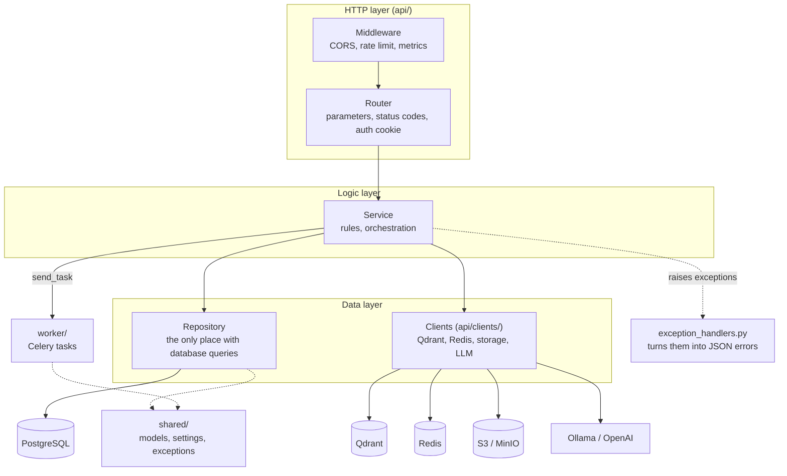
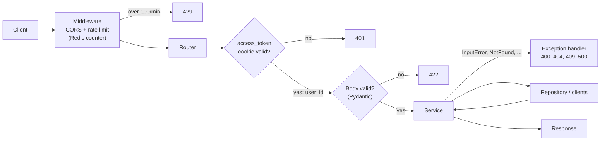

# Architecture

How Second Brain is built, as seen from the code. For setup see the [README](README.md), for details of the background processing see [worker/](worker/README.md), for AWS see [infra/](infra/README.md).

## Layers

Each feature (`user`, `document`, `chunk`, `chat`) in `api/modules/` has the same three layers. Every layer only talks to the one below it.

`shared/` is used by the API and the worker and imports nothing from either of them.

## One request, start to end

The `user_id` from the cookie is passed to every service call, so each query is limited to the signed-in user.

## Where the data lives

| Data | Stored in | Why there |
|---|---|---|
| users, documents, chunk text | PostgreSQL | relational data, migrations with Alembic |
| embeddings (dense and sparse) | Qdrant | similarity search, which Postgres cannot do well |
| the PDF files | S3 / MinIO | large binary files |
| processing status, chat cache, rate-limit counters, Celery messages | Redis | short-lived and fast, expires on its own |

## Main design decisions

- **Slow work leaves the request.** An upload only validates and queues a task. Two Celery workers read the PDF and create the embeddings, so the API stays fast.
- **Two worker types.** The embed worker holds the large embedding model, the PDF worker is light. They scale separately.
- **Hybrid search.** Dense vectors capture meaning, sparse vectors catch exact words. Qdrant merges both rankings (RRF).
- **One interface for the language models.** The service code does not care whether Ollama (development) or OpenAI answers.
- **Cookies instead of tokens in the body.** `HttpOnly` cookies keep the tokens out of reach of JavaScript.
