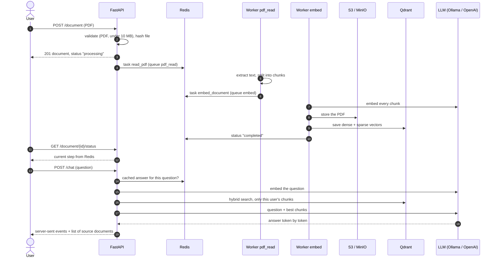
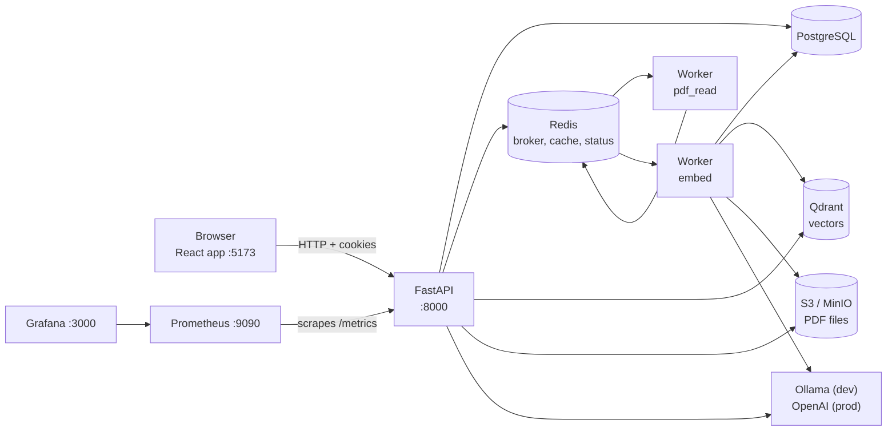

<h1 align="center">Second Brain</h1>

<p align="center">
  
  
  
  
  
  
</p>

Second Brain is a personal knowledge base. You upload PDF files and the backend turns them into searchable pieces. When you ask a question in the chat it finds the information that fit best and summarizes everything via a LLM.

This repository holds the **FastAPI backend**, the **Celery workers** that process documents, the **React frontend** and the **Terraform** code for the AWS deployment.

## Techstack

|                     |                                                                                                                                                                       |
| ------------------- | --------------------------------------------------------------------------------------------------------------------------------------------------------------------- |
| **What it does**    | PDF upload, text extraction, chunking, embeddings, hybrid search, streamed chat answers with sources                                                                  |
| **Backend**         | Python 3.12, FastAPI, async SQLAlchemy 2, Alembic, Pydantic settings                                                                                                  |
| **Background jobs** | Celery with Redis as broker, two queues (`pdf_read` and `embed`), one worker each                                                                                     |
| **Storage**         | PostgreSQL (users, documents, chunks) · Qdrant (vectors) · S3 or MinIO (the PDF files) · Redis (job status, chat cache, rate limit)                                   |
| **Language models** | Local in development: Ollama (`nomic-embed-text` for embeddings, `llama3` for answers). In every other environment: OpenAI (`text-embedding-3-small`, `gpt-5.4-nano`) |
| **Frontend**        | React + TypeScript + Vite, pages for login, chat and settings                                                                                                         |
| **Observability**   | Prometheus metrics at `/metrics`, Grafana dashboards                                                                                                                  |
| **Delivery**        | GitHub Actions (lint, tests, dependency audit), manual deploy workflow to AWS ECS, infrastructure in Terraform                                                        |

## From PDF to answer

Two flows make up the whole product. The first one runs in the background after an upload, the second one happens every time you ask something.



Identical uploads are detected through a SHA-256 hash, so the same file is never processed twice. Answers are cached in Redis for one hour per user and question.

## Building blocks



## Start the project

You need Docker with Compose. For the local language models you also need [Ollama](https://ollama.com) on your host machine, because the containers reach it through `host.docker.internal:11434` and Ollama is not running as a container via the Docker Setup.

```bash
git clone https://github.com/tomseidell/fastApi.git
cd fastApi

# 1. language models for development
ollama pull nomic-embed-text
ollama pull llama3

# 2. create a .env file in the project root (see the table further down)

# 3. build and start everything
docker compose up --build

# 4. create the database tables (second terminal, once after the first start)
docker compose exec api alembic upgrade head
```

| Service          | URL                             | Login                       |
| ---------------- | ------------------------------- | --------------------------- |
| Frontend         | http://localhost:5173           | register in the app         |
| API + Swagger UI | http://localhost:8000/docs      |                             |
| ReDoc            | http://localhost:8000/redoc     |                             |
| MinIO console    | http://localhost:9001           | `minioadmin` / `minioadmin` |
| pgAdmin          | http://localhost:5050           | `admin@admin.com` / `admin` |
| Qdrant dashboard | http://localhost:6333/dashboard |                             |
| Prometheus       | http://localhost:9090           |                             |
| Grafana          | http://localhost:3000           | `admin` / `admin`           |

Compose creates the MinIO bucket `second-brain-dev` automatically and points the API and both workers at the Redis, Qdrant and MinIO containers.

Stop everything with `docker compose down`. Add `-v` to also delete the stored data.

### Your first document

```bash
curl -X POST localhost:8000/user/register -H "Content-Type: application/json" \
     -d '{"email":"me@example.com","fullname":"Me","password":"a-strong-password"}'
curl -c cookies.txt -X POST localhost:8000/user/login -H "Content-Type: application/json" \
     -d '{"email":"me@example.com","password":"a-strong-password"}'

curl -b cookies.txt -X POST localhost:8000/document/ -F "file=@my-paper.pdf"
curl -b cookies.txt localhost:8000/document/1/status        # wait until it reports "completed"
curl -b cookies.txt -N -X POST localhost:8000/chat/ -H "Content-Type: application/json" \
     -d '{"message":"What is the main finding of the paper?"}'
```

The exact request fields are listed in the [API reference](api/README.md).

## Environment Variables

| Variable                                                         | Needed              | Meaning                                                                                                        |
| ---------------------------------------------------------------- | ------------------- | -------------------------------------------------------------------------------------------------------------- |
| `ENVIRONMENT`                                                    | yes                 | `development` uses Ollama and allows any CORS origin. Anything else uses OpenAI and only allows `FRONTEND_URL` |
| `DATABASE_USER`, `DATABASE_PASSWORD`, `DATABASE_PORT`, `DB_NAME` | yes                 | PostgreSQL credentials. Compose uses `postgres` / `postgres` / `5432` / `fastapi_db`                           |
| `DB_HOST`                                                        | yes                 | `db` inside Docker, `localhost` when the API runs on your machine                                              |
| `JWT_SECRET`                                                     | yes                 | Key that signs the login tokens. Use a long random value                                                       |
| `OPENAI_API_KEY`                                                 | outside development | Used for embeddings and answers                                                                                |
| `ALGORITHM`                                                      | no                  | JWT algorithm, default `HS256`                                                                                 |
| `ACCESS_TOKEN_EXPIRE_MINUTES`                                    | no                  | Default `30`                                                                                                   |
| `REFRESH_TOKEN_EXPIRE_MINUTES`                                   | no                  | Default `43200` (30 days)                                                                                      |
| `FRONTEND_URL`                                                   | no                  | Allowed CORS origin outside development, default `http://localhost:5173`                                       |
| `COOKIE_SECURE`                                                  | no                  | Set `true` behind HTTPS so cookies are only sent securely                                                      |
| `S3_BUCKET_NAME`, `S3_ENDPOINT_URL`                              | yes for uploads     | Bucket for the PDFs. The endpoint points to MinIO locally and stays empty on AWS                               |
| `DB_POOL_SIZE`                                                   | no                  | Connection pool size, default `16`                                                                             |

A minimal `.env` for the Docker setup:

```bash
ENVIRONMENT=development
DATABASE_USER=postgres
DATABASE_PASSWORD=postgres
DATABASE_PORT=5432
DB_NAME=fastapi_db
DB_HOST=db
JWT_SECRET=change-me-to-something-long-and-random
```

## Repository Map

```
├── api/                     FastAPI app
│   ├── main.py              app setup: middleware, CORS, metrics, lifespan
│   ├── routes.py            mounts /user, /document, /chat, /health
│   ├── modules/             one folder per feature: user, document, chunk, chat
│   │   └── <feature>/       router → service → repository, plus schemas, dependencies, tests/
│   ├── clients/             wrappers around Qdrant, Redis, storage and the LLMs
│   ├── middlewares/         rate limiting
│   └── exception_handlers.py
├── worker/                  Celery app and the two tasks (read_pdf, embed_document)
├── shared/                  settings, database setup, SQLAlchemy models, exceptions
├── alembic/                 database migrations
├── tests/                   integration and end-to-end tests
├── frontend/                React + Vite app
├── infra/terraform/         AWS: network, ECS, RDS, ElastiCache, S3, ALB, IAM
├── .github/workflows/       ci-backend.yml, cd.yml, migrate.yml
├── docker-compose.yaml      the full local stack
└── prometheus.yml           scrape config
```

## Testing

Pytest is used for testing. Install the test tools once with
`pip install -r requirements-dev.txt`.

| Level | Where | What it tests | Needs |
|---|---|---|---|
| Unit | `api/modules/<feature>/tests/`, `worker/*/tests/` | services and repositories in isolation | nothing |
| Integration | `tests/integration/` | the repositories against a real SQLAlchemy session on an in-memory SQLite database | nothing |
| End-to-end | `tests/e2e/` | the whole flow against the running stack: register, log in, upload a PDF, wait for `completed`, chat, delete | `docker compose up` and Ollama |

```bash
pytest -v --ignore=tests/e2e                       # unit + integration, the same selection CI uses
pytest api/modules/document                        # only one module
pytest --cov=api --ignore=tests/e2e                # with coverage for the API
pytest tests/e2e -v                                # end-to-end, API must be running on localhost:8000
```
