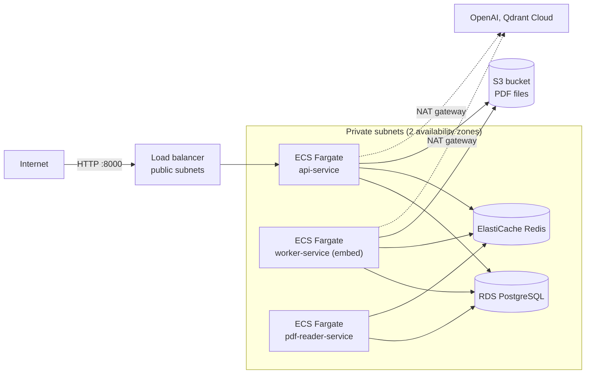

# Infrastructure

Terraform code that builds the AWS environment for the API and the two workers. It has two parts:

| Folder | Purpose | When you use it |
|---|---|---|
| `bootstrap/` | creates the S3 bucket and DynamoDB table that store the Terraform state | once, before everything else |
| `terraform/` | the actual services for SecondBrain: network, database, Redis, containers, load balancer | every infrastructure change |



Qdrant is **not** self hosted

## What gets created

| File | Resources |
|---|---|
| `network.tf` | VPC, public and private subnets in `az_count` availability zones, internet gateway, one NAT gateway per zone |
| `alb.tf` | load balancer with a listener on the API port and a target group with the `/health` check |
| `ecs.tf` | ECS cluster `main-cluster` plus three task definitions and services: `api-service`, `worker-service`, `pdf-reader-service` |
| `rds.tf` | PostgreSQL 18 on `db.t3.micro`, 20 GB, encrypted, 3 days of backups, password managed by AWS |
| `elasticache.tf` | one Redis node (`cache.t3.micro`), broker and status storage for Celery |
| `s3.tf` | private bucket `second-brain-main-<environment>` for the uploaded PDFs |
| `ecr.tf` | image repositories `api` and `worker` (one worker image serves both workers) |
| `secret_manager.tf` | secret with `OPENAI_API_KEY`, `QDRANT_API_KEY` and a generated `JWT_SECRET` |
| `iam.tf` | roles for ECS (pull images, write logs, read secrets) and for the app (access to the S3 bucket) |
| `security.tf` | security groups, see below |
| `logs.tf` | CloudWatch log groups `/ecs/api`, `/ecs/worker`, `/ecs/pdf-reader`, kept for 5 days |
| `templates/ecs/*.json.tpl` | container definitions with environment variables and secret references |

**Container sizes** (variables in `variables.tf`):

| Service | Default count | CPU | Memory |
|---|---|---|---|
| `api-service` | 1 | 0.5 vCPU | 1 GB |
| `worker-service` (embed) | 2 | 1 vCPU | 4 GB |
| `pdf-reader-service` | 1 | 0.25 vCPU | 0.5 GB |

The embed worker gets the most memory because it holds the embedding model and the PDF content. Both workers run the same image, the `WORKER_TYPE` variable in the task definition (`embedder` or `pdf_reader`) selects which queue they consume.

## Setup

You need Terraform 1.2 or newer and an AWS CLI profile named **`admin`** (`provider "aws"` uses it) with enough rights to create the resources above.

```bash
# 1. state storage, once
cd infra/bootstrap
terraform init && terraform apply

# 2. the environment
cd ../terraform                 # run from this folder, the templates are loaded with relative paths
terraform init                  # connects to the S3 backend
terraform plan
terraform apply
```
Create `terraform.tfvars` in `infra/terraform/` with these variables:

| Variable | Meaning |
|---|---|
| `region` | AWS region, the bootstrap uses `eu-central-1` |
| `az_count` | number of availability zones to use, for example `2` |
| `api_port` | port of the API and the load balancer listener, `8000` |
| `redis_port` | `6379` |
| `db_user`, `db_name` | PostgreSQL user and database name |
| `openai_api_key`, `qdrant_api_key` | stored in Secrets Manager |
| `qdrant_url` | URL of your Qdrant Cloud cluster |
| `environment` | `dev` by default, part of the bucket name |

## Deploying changes

- **Infrastructure** changes go through `terraform plan` and `apply` as above.
- **Application** changes are deployed by the **CD** workflow. It builds the images, pushes them to ECR and rolls out new task definitions for the three services.
- Logs: CloudWatch, or `aws logs tail /ecs/api --follow`.
