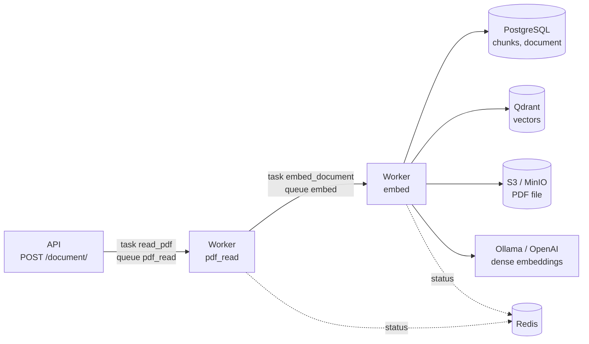

# Worker

The Celery workers turn an uploaded PDF into searchable data. The API only validates the upload and hands the file over,
everything slow and blocking happens here. There are two workers built from **one image** (`worker/Dockerfile`), each listening on
its own queue. We excluded these features from the main API, as they are blocking and therefore would slow down the application drastically.
Because we are using SQLAlchemy, compromised or malicious PDF's will not allow for and SQLInjection. Also, if the PDF is compromised only the worker will be killed, while the main API will always keep running



## The two workers

| | `pdf_read` worker | `embed` worker |
|---|---|---|
| Task | `read_pdf` in `tasks/read_pdf.py` | `embed_document` in `tasks/process_document.py` |
| Queue | `pdf_read` | `embed` |
| Compose service | `worker-pdf` | `worker-embed` |
| Does | extracts the text with PyMuPDF, cleans it, splits it into chunks (2048 characters, 100 overlap) | saves the chunks, creates dense and sparse embeddings, writes the vectors to Qdrant, stores the PDF, marks the document `completed` |
| Retries | 2, for PDF and text-splitting errors | 3, for Ollama, Qdrant and storage errors |
| Time limit | 120 s soft, 150 s hard | 300 s soft, 350 s hard |
| Memory | light | heavy: loads the sparse model (SPLADE via FastEmbed) |

They are separate so the high memory embedding model only lives in one process, and so a slow PDF cannot block embedding jobs.
Both run with `--concurrency=1`. For intense local development, the concurrency can also be increased to handle more uploads at a time. 

## How a document moves through

1. The API saves the document and sends `read_pdf` with the PDF as **base64 text** (the broker only carries JSON).
2. The `pdf_read` worker extracts and chunks the text, then sends `embed_document` with the chunks.
3. The `embed` worker creates the chunk rows, the embeddings and the Qdrant points, uploads the PDF to `user_<id>/<file>` and finishes the document.
4. After every step the worker writes `{status, message}` to Redis (`document:status:<id>`, kept for one day). The API serves it at `GET /document/{id}/status`.

Status values: `reading_pdf` → `chunking` → `embedding` → `completed`, or `failed` at any point.

## When something goes wrong

- A failed step sets the status to `failed`, rolls back the database and marks the document `failed` with a short message.
- The `embed` worker also **undoes its partial work**: it deletes the Qdrant points and the uploaded file, so nothing half-finished stays behind.
- Tasks use `acks_late` and `retry_backoff`, so a crashed worker's task is delivered again and a retry waits longer each time. Tasks must therefore be safe to run twice.
- Limits: extracted text up to 5,000,000 characters. A PDF that cannot be read fails with "Invalid or corrupted PDF".

## Configuration

| Variable | Meaning |
|---|---|
| `CELERY_BROKER_URL`, `CELERY_RESULT_BACKEND` | Redis, default `redis://localhost:6379` |
| `REDIS_URL` | status storage, same Redis |
| `QDRANT_URL`, `QDRANT_API_KEY` | vector database |
| `S3_BUCKET_NAME`, `S3_ENDPOINT_URL` | file storage, the endpoint points to MinIO locally |
| `OLLAMA_HOST` | embedding model in development |
| `ENVIRONMENT` | `development` uses Ollama (`nomic-embed-text`), anything else OpenAI (`text-embedding-3-small`) |
| `DENSE_VECTOR_SIZE` | size of the dense vector, default `1536`. It must match the model and is fixed when the collection is created |
| `WORKER_TYPE` | `embedder` loads the sparse model at start instead of on the first task. Without a command, the image starts the `pdf_reader` worker for `pdf_reader` and the embed worker otherwise |

> **Watch out:** `1536` fits OpenAI. With Ollama's `nomic-embed-text` the size is `768`, so set `DENSE_VECTOR_SIZE=768` before the
> collection `second_brain` is created for the first time. If it already exists with the wrong size, delete it in the Qdrant dashboard.

Database settings (`DB_*`, `DATABASE_*`) come from `shared/config.py`, like in the API.

## Run and debug

```bash
docker compose up -d worker-pdf worker-embed            # start both
docker compose logs -f worker-embed                     # follow one
docker compose restart worker-pdf worker-embed          # after code changes, workers do not auto-reload


pytest worker                                           # unit tests, everything is mocked
```

## Folder map

```
worker/
├── celery_app.py        Celery setup, queue routing, lazy loading of the Qdrant/embedding service
├── tasks/               the two tasks: read_pdf.py, process_document.py (embed_document)
├── document/            PDF text extraction and chunking, document repository, exceptions
├── chunk/               creates chunk rows
└── clients/             Qdrant, Redis, S3 storage and LLM (Ollama / OpenAI) clients
```

The worker is **synchronous** (`SyncSessionLocal`) and never imports from `api/`. Shared models and settings live in `shared/`.
